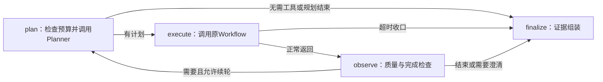
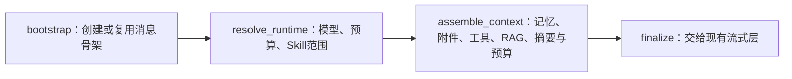

# LangGraph 全量迁移计划与阶段记录

日期：2026-11-06。用户已授权提交既有记忆优化，并按阶段将整个知识工作台的业务编排迁移至 LangGraph。详细任务、文件和验收见 [实施计划](../plan/refactor-langgraph-runtime-1.md)。当前已实现阶段0—2，阶段2最终验证/提交见[210](210_LangGraph阶段2_Chat主链改造与验证_2026-11-06.md)；后续阶段不是已经完成的能力。

## 1. 起点与目标

已先提交推送记忆索引优化 `25f355b`，GitHub Actions `42143751282` 的 backend/frontend 均为 success。本地此前1094项回归、PG/Redis、在线模型和浏览器结果属于记忆阶段，不冒充新迁移测试。

迁移的对象是决定“下一步做什么”的业务编排。FastAPI、Next.js、SQLAlchemy、PG、Redis、Provider、RAG、Memory、MCP/Skill、Executor继续承担原职责。不把CRUD路由、SQL执行或HTTP代理为了形式改成图，也不借迁移开放新权限。

最终链路希望形成：Chat图负责准备/检索/记忆/工具子图/预算/生成；同步工具图负责规划/执行/观察/续轮；Durable、审批、文档、记忆提取与知识索引分别有图阶段。图检查点表示执行位置，正式消息、审批、文件版本和产物仍由业务数据库确认。

## 2. 分阶段路线

| 阶段 | 主要工作 | 必须验证后才能进入下一步 |
| --- | --- | --- |
| 0 起点与依赖 | 推送记忆优化，核对版本，依赖安装与pip check | 可回退Git提交、原功能测试、没有默认开启外部Trace |
| 1 同步工具循环 | plan→execute→observe→继续/finish；临时保留显式legacy对照 | 预算、DAG、部分失败、意图/参数/权限、取消与真实最终回答不退化 |
| 2 Chat主链 | prepare→检索/记忆→工具子图→预算→生成/收口，适配原NDJSON | RAG/Tool/混合、停止/断连/超时、generation/CAS、最终来源一致 |
| 3 Durable与检查点 | PG检查点、Run映射、Worker租约和图恢复 | 强制退出、旧Worker、重复handoff、产物先提交而检查点滞后时不重做 |
| 4 审批恢复 | 写入前interrupt，真实Diff/Approval，确认后resume | 用户/版本/参数复核、拒绝、重复确认、文件变更、暂停后重启 |
| 5 文档交付子图 | 取证→草稿→导出→完成；保存另接审批 | Word/Markdown下载、保留成功产物、可选保存、原会话回传 |
| 6 记忆/索引后台图 | 记忆来源/提取/核验/保存；文档解析/索引/代际切换 | Outbox/Redis/ACK不变、重复Job与源编辑、失败恢复、查询性能 |
| 7 最终清理与验收 | 删除临时旧入口，版本兼容和文档归档 | 固定与独立业务集、真实模型/浏览器/Worker、故障注入、CI、简历口径 |

各阶段按顺序完成，不提前改变后续阶段的状态与恢复模型。这里的“全量”指所有业务编排入口最终统一，并不是将框架能表达的每个函数都拆成节点。

## 3. 阶段1实际实现

依赖版本：LangGraph 1.2.20、langchain-core 1.7.6、langsmith 0.14.17；LangGraph和core发布日期经PyPI核对为2026-11-05，Python最低3.10，现有环境符合。先dry-run再安装，pip check通过。附带的httpx2由依赖安装，不替换项目直接使用的httpx 0.28.1/OpenAI SDK。

`ExternalContextService.build_context()`仍是Chat调用入口。启用工具时创建每请求独立SyncToolRun，通过StateGraph执行下列节点：

State只记录轮次、动作、终止原因、来源与调用计数；凭据、Session、Provider客户端不放入State，业务步骤对象放请求级Runtime Context。本阶段没有Checkpointer，不承诺同步Chat崩溃恢复。编译的图可缓存结构，各请求的sources/observations/budget/ledger互不共享。

Planner输出ToolPlan，原ToolWorkflow继续执行DAG、依赖、绑定、并发、质量检查和失败聚合；Executor继续参数/ACL/凭据/风险/SSRF/意图边界校验。Skill完成、证据投影、来源去重、call_id跨轮隔离和固定模式预算保留。

默认 `TOOL_ORCHESTRATION_ENGINE=langgraph`。`legacy`仅作为服务端明确配置的迁移对照，复用相同业务步骤；图异常/取消不会自动转旧链重新调用工具。阶段7才删除该临时入口。图recursion_limit按业务合法节点数另设，不能把一个图superstep当一次Planner轮次。

每节点追加 `tool_graph_node` 到原有结构化工具Trace，记录节点/轮次/已用调用数，不包含原始参数或凭据。不创建第二套日志库。显式使用tracing_context(enabled=False)，即使宿主遗留LANGSMITH_TRACING=true也不发送图Trace到外部平台。

## 3.1 阶段2第一段：Chat准备图（历史步骤）

阶段2先处理入口和状态边界，不立即重写已经稳定的上下文业务。新问题、重生成和编辑重答都通过 `ChatExecutionService` 创建独立的 `ChatGraphContext`，由同一张图依次执行：

图State只保留阶段、消息ID、generation、证据数量和诊断计数；Session、认证用户、API Key、Provider配置和ORM对象都在请求级Runtime Context中。`assemble_context`目前复用原有 `ChatContextAssemblyService`，因此短事务、记忆/RAG失败降级、来源映射、上下文治理和最终generation校验保持不变；流式NDJSON、首包/空闲/总超时、取消和失败落库仍由现有路由负责。下一段再把assemble内部拆成记忆/RAG、工具和预算节点，不把当前阶段夸大为Chat全链路完全图化。

## 3.2 阶段2完整Chat编排

第一段里的assemble节点内部已迁出为上下文子图：snapshot→memory→tools→rag→summary→govern→context_ready；tools调用阶段1真实工具图。生成与终态保存交给chat_stream_graph的generate/persist_terminal；HTTP路由保留协议、超时适配和取消收口。两张图按HTTP流开始前后连接，无Checkpointer、不续token。完整文件映射、版本保护、日志提交和真实失败排查见[210](210_LangGraph阶段2_Chat主链改造与验证_2026-11-06.md)。

## 4. 历史验证记录（阶段1及阶段2第一段）

新增11项图专项已通过：真实条件边、无工具跳过执行、两轮观察与call_id隔离、新旧业务输出一致、完整8轮不被递归上限误截、零剩余预算、取消/异常不回退、并发请求隔离、禁用宿主外部Trace、未知引擎拒绝。

阶段2第一段新增2项Chat图专项，完整后端1107项通过，含真实PG/Redis；迁移前1105项全部保留。compileall、pip check、git diff --check通过。

第一次真实浏览器包装运行已到结果收集，但新增测试误用ToolRouteRun.project_id导致脚本失败（实际字段在Conversation）；已改为通过会话关联查询，重跑结果另记。错误由测试包装触发，不计作业务验收通过。

真实DeepSeek-V3.2与浏览器的文件search→read→最终回答→数据库校验通过；Trace含plan/execute/observe两个循环及finalize，消息done、工具route success、实际两次调用。见[浏览器报告](../backend/evals/results/langgraph-phase1-real-20261106-r3.json)。

真实在线故障验收最终r4通过：两文件并行其中一个受控超时，成功的7天事实被回答、未读的41天未编造，route partial、assistant done、调用success/timed_out；规划模型受控超时且没有安全兜底时工具0调用、route error，但最终回答done并披露未完成。见[故障报告](../backend/evals/results/langgraph-phase1-faults-20261106-r4.json)。临时项目/文件/会话均清理，未使用Ollama。安全兜底场景显式收窄测试候选且不提供file_id；生产兜底继续保留。

不得把最终通过掩盖中间失败：[全部尝试记录](../backend/evals/results/langgraph-phase1-attempts-20261106.json)保留首次测试字段错误、旧故障前提不成立，以及r3一次最终答案数字/未完成披露检查失败。该次原文未保留，不能断言只是词面误判或已定位为框架回归；独立复跑及r4通过不等于所有模型尝试零失败。

另测预热后的无工具编排各100次，legacy P50/P95=2.198/2.529ms，图为4.722/4.881ms，约增加2—3ms；收益是结构与维护，不是声称更快。见[组件开销](../backend/evals/results/langgraph-phase1-overhead-20261106.json)。此测试没有模型/数据库/持久化，不是整条Chat延迟。

阶段1实现与阶段2第一段本地验收完成：工具图代码提交 `309fb82`，Chat图代码仍待本轮阶段提交。工具图 GitHub Actions `42147166908` 的 backend 与 frontend 均通过；Chat图新增真实浏览器回归报告见 `backend/evals/results/langgraph-phase2-chat-browser-20261106.json`，文档同步和阶段提交在本段验收后完成。下一步继续拆分Chat内部检索、记忆、工具和预算节点；记忆阶段的CI成功不与本次图迁移结果混用。

## 5. 代码对应关系

| 文件 | 责任 |
| --- | --- |
| `backend/app/services/external_context_service.py` | 原Chat门面；创建请求上下文并选择编排器；公共输出格式保持 |
| `backend/app/services/tools/loop_runtime.py` | 从旧循环提取规划、执行、观察和收尾业务步骤；短期legacy对照共用 |
| `backend/app/services/agent_graph/sync_tool_graph.py` | StateGraph节点、条件边、递归保护、节点Trace和本地追踪策略 |
| `backend/app/services/agent_graph/chat_graph.py`、`chat_graph_state.py` | Chat准备图、请求级Runtime Context和可序列化阶段诊断 |
| `backend/app/services/chat_execution_service.py` | 新问题、重生成和编辑重答统一进入Chat图；异常/取消按generation收口 |
| `backend/app/core/config.py`、`backend/.env.example` | 服务端迁移引擎配置，默认langgraph |
| `backend/requirements.txt` | 固定实际验证的框架版本 |
| `backend/tests/test_sync_tool_graph.py` | 图流程、新旧一致性、取消、隔离和外部Trace控制 |
| `backend/tests/test_chat_graph.py` | Chat图的新问题/已有回合路径及阶段顺序 |
| `scripts/langgraph_phase1_real_e2e.py` | 复用真实业务脚本并核对图节点被持久化 |

后续阶段具体修改路径和退出标准以实施计划为准。本轮不提前添加PG图检查点、重写Durable或修改文件审批。

## 6. 参考与边界

- [LangGraph Graph API](https://docs.langchain.com/oss/python/langgraph/graph-api)
- [Persistence](https://docs.langchain.com/oss/python/langgraph/persistence)
- [Durable execution](https://docs.langchain.com/oss/python/langgraph/durable-execution)
- [Interrupts](https://docs.langchain.com/oss/python/langgraph/interrupts)

迁移收益是减少未来图编排与状态分支的自写维护；并不保证模型更准确、数据库容量更高、工具副作用exactly-once。脚本沙箱仍不具备Rootless真实容器验收条件，不因LangGraph接入而放开执行。
