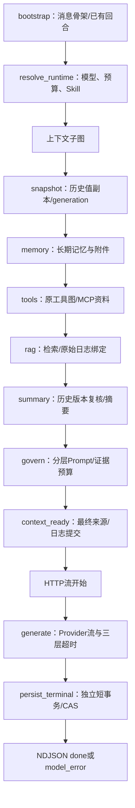

# LangGraph 阶段2：Chat 主链改造与验证

2026-11-06。前置提交为 `196f8dd`，详细迁移范围仍以 [总计划](../plan/refactor-langgraph-runtime-1.md) 为准。阶段2已实现并完成下述本地验收；提交/CI记录以阶段提交和Actions为准，Durable检查点属于阶段3。

阶段提交 `1197b59` 已推送；GitHub Actions `42164080330` 的 backend/frontend 均成功。飞书当前项目入口已更新阶段2完整链路与验收，最终提交状态在原段定点补充。阶段1 `309fb82`、准备图第一段 `196f8dd` 均保留为Git回退边界。

## 实际调用链

HTTP 请求认证后进入 `ChatExecutionService`，新问题创建消息骨架，重生成/编辑重答复用原消息并更换 generation。准备图组织运行时与上下文子图，准备成功才创建 HTTP 流。随后生成图组织在线模型与保存终态，路由继续适配 NDJSON：

准备与生成用两张图连接，是为了保留“准备错误返回 HTTP 错误、生成中错误返回 NDJSON”的接口边界。不会在请求进入时先发 200 再做认证/消息创建，也不会为了图持久化保存 API Key。子图各步骤的调度已从单个组装函数迁出，原业务处理仍留在服务中。

## 实现文件

| 文件 | 责任 |
| --- | --- |
| `agent_graph/chat_graph.py`、`chat_graph_state.py` | 准备入口、消息/运行时/子图交接；State只留ID、阶段和最终来源标签 |
| `chat_assembly_runtime.py` | 每请求独占的中间数据，含原文副本、各来源和治理结果；不持久化 |
| `agent_graph/context_graph.py` | snapshot/memory/tools/rag/summary/govern/context_ready七个真实节点 |
| `chat_context_assembly_service.py` | 对应步骤的业务实现；保留原参数、模式、质量、安全、来源及预算语义 |
| `agent_graph/chat_stream_graph.py` | generate/persist_terminal；请求级单槽事件桥接、消费确认、取消传播 |
| `api/routes/chat.py` | Provider选择、三层超时、NDJSON适配、公开错误和取消后保存partial |
| `chat_execution_service.py` | 捕获准备异常/取消并按冻结generation收口，新问题/重生成共用图 |

以上服务文件均在 `backend/app/services/` 下，路由在 `backend/app/` 下。

## 必须保持的边界

1. 不把 Session、认证用户、API Key、Provider客户端、Prompt正文放进图State；运行时对象只存在于当前请求，外部LangSmith追踪显式禁用。本阶段无Checkpointer。
2. 共享请求Session的上下文节点保持串行，节点均以异步函数在事件循环线程执行，不让LangGraph的同步节点线程池跨线程使用ORM。记忆检索本来就有独立短Session/线程池，仍按现有服务执行。
3. 图不自动重试模型、工具或整个旧流程。工具内部有限重规划/重试继续使用原预算和Executor。
4. 工具子分支失败仍可部分回答；RAG降级/记忆回退沿用原服务；历史或generation发生冲突仍拒绝本轮上下文。不能把任何异常统一当空结果。
5. 最终Prompt、最终来源映射、消息来源及检索日志继续使用预算后的同一来源集合。发现最终日志只有flush、流前关闭Session会回滚，已补短事务提交。
6. 重生成准备失败/取消使用进图前复制的generation，不能回头读已刷新ORM。上下文子图也接受该版本，避免节点之间的await引入换代窗口。
7. Python3.10下本版本框架custom writer依赖的ContextVar没有自动传播，实际报outside runnable。改用请求级单槽队列桥接图节点与HTTP消费者；每个事件等待消费者处理后再继续，不缓存整个答案，也防止usage未处理就提前保存。
8. 模型生成失败在图终态节点保存failed，路由不重复保存；用户断连/停止的CancelledError透传，关闭图任务和Provider后由原shield短作用域保存cancelled及partial。

## 验证记录

- 第一轮定向：71项通过，包含真实PostgreSQL、摘要历史冲突和流式CAS；补重生成旧版本取消后定向45项通过。
- 最终完整后端1121项通过，真实PostgreSQL/Redis、无跳过；较第一段1107项新增14项。包含最终来源在请求Session关闭后仍已提交、重生成旧版本取消保护。compileall、pip check、git diff --check通过。
- 新增9项图阶段/流式专项：七阶段顺序和同线程、请求隔离、异常不重跑工具、增量返回/usage处理顺序、部分错误保存一次、内部取消、消费者关闭、外部取消、过期generation拒绝。
- 真实浏览器已通过：在线Planner→search/read→最终回答→数据库；持久化指标同时包含七个上下文节点和generate/persist_terminal，工具Trace包含两轮plan/execute/observe及finalize。见 [浏览器r2](../backend/evals/results/langgraph-phase2-browser-20261106-r2.json)。未加载Ollama。
- 在线HTTP最终[r5七场景](../backend/evals/results/langgraph-phase2-real-20261106-r5.json)全部通过：普通、重生成、编辑重答、RAG、工具、混合、断连。六次完整回答done，RAG6来源、混合9来源；正文/状态、generation变化、持久化图阶段与来源一致性校验通过。断连保留1字符partial，15秒内收口cancelled。耗时仅为单次验收记录，不当作P95或性能提升。
- [真实故障两场景](../backend/evals/results/langgraph-phase2-faults-20261106-r1.json)通过：并行文件读取一成功一受控超时，已读7天事实使用、未读41天不编造，route partial且回答done；Planner受控超时且没有安全兜底，0次工具调用、route error，真实最终模型披露未完成且消息done。首包/流中空闲/总时长超时和停止后的failed/cancelled及CAS由真实PG集成/单测补充覆盖，不把这些受控错误说成Provider真实故障。
- 中间失败不覆盖：r1脚本把文件来源类型写为workspace_file；r2、r3工具任务无读取证据。后来用r3的候选事件和原问法定位：`FILE_EXCLUSION_PATTERN`的`只.{0,5}联网`把“只读文件，不联网”误认成“仅联网”。已改为仅允许明确连接词，补3项规则/异步降级回归；不联网仍不能放行网页工具，仅网页仍排除文件。该问题与是否激活Skill无关，属于原有筛选规则缺陷。
- r4实际完成search/read，但脚本额外要求回答重复文件名，题目只要求第一行和用途，因此仍记录断言失败；修正为检查第一行原文、用途及来源卡片文件名。r5通过的是修正后的业务断言，不与r1—r4拼成“全尝试零失败”。所有失败报告原样保留。

## 后续

阶段2完整验证后提交并核对CI，再进入阶段3：PostgreSQL图检查点与既有AgentRun/Step、租约、幂等和恢复事实的衔接。当前普通Chat仍随浏览器连接取消，不支持续生成中断的token。
