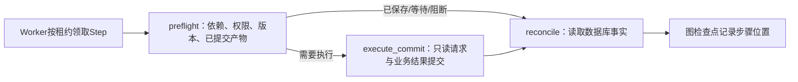

# LangGraph 阶段3：Durable 检查点与租约恢复

2026-11-06。承接阶段2 `1197b59`/`c4f25f4`，实施范围为[总计划](../plan/refactor-langgraph-runtime-1.md)的TASK-013—016。审批、文档、记忆和索引图仍属于后续阶段，不因本阶段接入检查点而变成通用自主Agent。

## 用户侧流程

普通Chat仍同步执行。用户在工具追踪中预览后台重执行，预览不创建Run；确认后才创建Run/Step/Outbox。独立Worker领取步骤，执行下面的图，完成后回传原会话：

每个Step独立thread，避免同Run并行分支争写同一检查点。Worker领取、续租、退避、死信仍是基础设施；图决定步骤内的预检、执行与收口。工具仍须低风险只读，文件写入继续走原审批链，未开放任何新高风险工具。

## 两类状态各自负责什么

业务表`AgentRun/AgentStep/AgentArtifact/AgentCheckpoint`仍表示正式状态、结构化产物和业务审计。LangGraph原生检查点表示本Step图节点执行到哪里，只保存步骤ID、状态、产物ID和租约版本，不存原始工具参数、正文、Session、凭据或客户端。

检查点可能落后于业务提交。如果Artifact已提交，不能因为图仍停在execute节点就重做已完成步骤；先从业务表复核，必要时恢复步骤终态并复用同一份产物。未提交的外部只读请求则可能再次执行，这是至少一次边界，不能宣称exactly-once。最后的Run收口与原会话结果消息仍在同一业务事务中提交。

新任务在planner_state中记录`runtime_engine=langgraph_tool_v1`。历史无该字段的任务保留原恢复入口；明确未知版本拒绝执行，不默认为旧版。SQLite只用于业务单测，运行同一节点图但没有PG检查点持久化，不把它当生产恢复证据。

## 存储、命名和写入保护

显式迁移`20261106_01`创建独立`aiws_graph` schema，采用锁定的`langgraph-checkpoint-postgres==3.2.0`原生表结构。业务表不搬家，服务仍使用PG35433、API32007、前端32008。

原生表为checkpoints、checkpoint_blobs、checkpoint_writes、checkpoint_migrations。runtime_threads把框架thread映射到正式Run/Step，Run或Step删除时级联清理图数据。`thread_id`编码运行时版本、用户、项目、Run和Step；`checkpoint_ns`为空的根命名空间。权限来自服务端Run及本次claim，不接受前端自定thread_id。

Web/Worker生命周期独立管理异步连接池，单池min=0/max=4；独立脚本使用短生命周期池。检查点连接可在当前Step期间保留，但外部请求期间不持有检查点数据库事务。写入时在同一短事务锁定Outbox事件行并复核：用户/项目/Run/Step范围、事件与Step租约版本、当前owner、有效期及任务状态；然后才写原生检查点或pending writes。先检查后换另一条连接写入会有竞态，本实现不采用那种方式。

业务产物提交也拒绝过期租约和已取消Run。受控重放创建新Outbox事件时，租约版本按该Step及其全部历史事件最大版本递增，不能重置回1；同时刷新已锁定对象，不能仅信任Session中旧ORM值。否则旧事件和新事件最终都可能回到相同版本，破坏Fencing。

业务提交后owner会清空；只要仍是最后这个租约版本且业务状态相容，允许补齐仅含ID的图记录。新租约一旦接管，旧图的写入仍必须失败。CancelledError不换旧引擎重试，CheckpointLeaseLost只让旧执行者退出，不把新Worker的步骤标为失败。

## 文件与责任

| 文件 | 实现内容 |
| --- | --- |
| `backend/app/services/agent_graph/durable_graph.py` | preflight/execute_commit/reconcile、原生产物复核、从未完成图位置继续 |
| `backend/app/services/durable_checkpoint_service.py` | thread范围、PG池、原生Saver及同事务租约写入保护 |
| `backend/app/services/durable_tool_runtime.py` | 运行时版本分派、提取预检/结果业务步骤、保留DAG/质量/重试/DLQ、单调租约及旧Worker拒写 |
| `backend/migrations/versions/20261106_01_LangGraph检查点.py` | 独立schema、原生结构、业务映射与级联清理；不在启动时setup |
| `backend/app/main.py` | Web生命周期连接池检查/回收 |
| `backend/requirements.txt` | 锁定PG Checkpointer和psycopg-pool依赖 |
| `backend/tests/test_durable_graph_postgres.py` | 真实PG、独立进程宕机、并发接管、范围/过期/取消、重放版本和清理 |
| `scripts/langgraph_phase3_real_e2e.py` | 在线Chat、浏览器确认/关闭、独立Worker、产物/图记录/结果回传与重复确认 |

## 验证与实际限制

最终完整后端1138项通过，含真实PostgreSQL/Redis，无跳过；较阶段2新增17项PG图专项。此前37项既有Durable业务、7项迁移测试也保留通过。PG专项从原生读写7项逐步扩到宕机/清理12项、并发/接管15项，再补重放版本和取消后拒写。compileall、pip check、git diff --check通过。

| 故障窗口 | 预期恢复结果 | 外部只读请求次数 |
| --- | --- | --- |
| 发请求前进程退出 | 新Worker从未完成位置继续 | 最终1次 |
| 外部返回、业务提交前退出 | 未提交产物重做，最终一份Artifact | 可2次 |
| A产物提交、图检查点前退出 | A复用，继续依赖A的B | A只1次 |
| 原会话结果提交前退出 | 事务回滚后恢复，最终一份结果消息 | 可2次 |

这些是隔离数据库中的真实spawn子进程和`os._exit`，不是在Web请求里抛一个异常冒充宕机。对成功产物已保存但图最终记录仍滞后的完成Step，业务事实优先；不要求重跑它来把图记录“刷成完成”。

[真实浏览器r2](../backend/evals/results/langgraph-phase3-real-20261106-r2.json)通过：在线Chat实际调用文件工具，浏览器预览时Run未创建，确认后queued；关闭浏览器才恢复独立Worker，任务succeeded，一份Artifact、5条原生检查点、回传原会话；同令牌和新预览重复确认均复用同Run，重新打开浏览器可见结果，页面错误0。r1仅因测试定位器未包含折叠区域的隐藏按钮而超时，Worker及临时项目已恢复/清理，原报告保留，不算业务通过。

最后补齐重放事件租约单调性与取消后拒写后，重启原后端和Durable Worker，再执行[真实浏览器r3](../backend/evals/results/langgraph-phase3-real-20261106-r3.json)，上述检查全部再次通过；本阶段最终线上验收以r3为准。

正式库已在暂停本项目写入者后完成全量备份，再事务迁移；备份位于仓库外`/disk2/gengnan/aiws-backups/20261106-langgraph-stage3-d5d9c452`，不提交其中数据/凭据。迁移后恢复原单套Supervisor角色，未启动Ollama或额外Web服务。

回退应用代码时应保留当前Alembic迁移记录与版本文件，不要直接删除aiws_graph或盲目stamp旧版本。新增表不替代业务事实，历史运行时仍可解释；如要数据库降级，必须先备份并评估检查点丢失，不能把删除检查点当常规回退操作。

下一阶段是审批interrupt/resume：仍需真实Diff、批准、基线版本和CAS，不复用只读Worker的权限放开写入。

代码已独立提交并推送`6046b70`；GitHub Actions `42168344317`的backend/frontend均成功。飞书当前项目入口已定点同步并回读。
