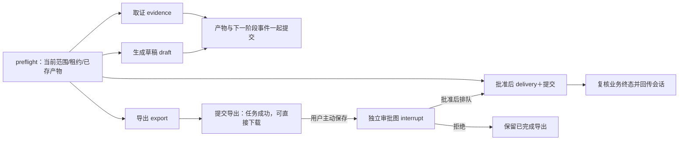

# LangGraph阶段5：文档交付与可选保存

2026-11-06，承接阶段4`39dc82c`。文档取证、草稿、导出与可选保存已接入真实图节点；保持“生成即可下载，保存到工作区另行批准”。当前总口径见[209](209_LangGraph全量迁移计划与阶段记录_2026-11-06.md)和[详细任务](../plan/refactor-langgraph-runtime-1.md)。

## 业务链路

用户选择工作区资料或已完成的会话回答，提交文档任务。原事务创建Run、四个Step和首个Outbox事件。独立Worker按租约领取准备好的Step，由图选择对应节点：

每个Step都有自己的原生执行图；首个预检从业务表重建运行时、检查租约并增加实际尝试次数。四个阶段在图中分别是evidence/draft/export/delivery节点，各自的提交节点明确决定下一阶段或结束，不再让新运行时同时依赖一套隐藏旧循环来决定阶段转换。

草稿/导出正文只保存在本次Runtime和已有AgentArtifact中，图State只记录Step、阶段、租约版本、产物ID和状态。模型生成前结束数据库事务；未提交草稿宕机可重新生成，已提交草稿直接供导出使用，不重新调用模型，不续接中断token。

导出提交后Run为succeeded，delivery仍planned；用户不保存也可打开、下载Markdown或Word，不自动创建审批或项目文件。用户选择保存后才创建/复用AgentApproval，进入独立保存审批图；批准后原事务消费审批并创建delivery事件。Worker交付时再读当前权限、批准状态及参数，写入固定的本Run独占产物路径并创建项目文件，不接受任意本机路径或覆盖既有用户文件。

拒绝保存会回到“生成成功、未保存”，不取消已完成导出。有效的重复申请保存不再递增业务版本，避免重复HTTP请求让正在等待的图失效。过期审批可由用户明确重新申请并生成新的确认挑战；旧令牌不能复用。完成/失败仍回传原会话，同Run更新同一条消息；阶段失败保留此前产物。

## 持久化、审批与恢复

新文档Run标记`langgraph_document_v1`；执行图与可选保存审批图分别使用`langgraph_document_v1`、`langgraph_document_approval_v1`线程。delivery同一个业务Step需要这两种图，所以显式迁移`20261106_02`把runtime_threads的唯一约束从step_id改为(step_id,runtime_key)。thread主键、Run/Step外键和级联清理不变；既有数据从thread前缀回填运行时，不修改业务表/产物。

审批和执行使用不同线程，Web确认不会争用Worker的执行位置。审批图只保存用户等待与决定，不直接写项目文件；执行图仍由当前Outbox/Step租约授权。已经消费的审批不可逆，允许其图记录在Worker进展之后补齐ID级元数据，不能凭旧图重新授予保存权限。旧无版本文档任务保留原恢复入口；明确未知版本失败关闭。

检查点不等于业务事实。Artifact、下一阶段事件、Run状态和原会话消息仍按原短事务提交。文件交付与业务提交在同一个图节点，完成后才保存图检查点；不能在持有业务事件锁时让另一个Saver连接等同一把锁。只读阶段也先结束只读事务再交给检查点。

领取任务新增业务Step约束：迟到事件不能把已完成Step改回running；同Step的另一个pending事件不能抢走有效租约。当前事件的owner/version匹配且已过期时仍可接管，即使Step镜像的到期字段尚未同步，避免把旧Worker永久卡住。新租约版本继续跨该Step所有事件单调增加。

正式库已先暂停本项目写入者并备份，再事务迁移，随后恢复原单套服务。备份在仓库外`/disk2/gengnan/aiws-backups/20261106-langgraph-stage5-c2b07e27`。不在Web启动时setup或改表。已有Step存在两种图时，数据库降级不能自动丢其中一份记录；降级唯一约束会明确失败，需另行评估，不当作常规应用回退。

## 实现文件

| 文件 | 责任 |
| --- | --- |
| `backend/app/services/agent_graph/document_graph.py` | 四个明确业务节点、各自提交转换、交付原子节点、Artifact恢复与终态复核 |
| `backend/app/services/agent_graph/document_approval_nodes.py` | 可选保存interrupt、当前用户/版本/令牌复核、消费审批后排队，拒绝仍保留下载 |
| `backend/app/services/document_task_worker.py` | 提取prepare/execute/commit/fail单阶段业务，图版本分派，原Heartbeat/Fencing/Retry/DLQ保留 |
| `backend/app/services/document_task_service.py` | 新Run运行时标记、原事务产物/事件/消息、保存申请幂等、审批原子消费、历史运行时 |
| `backend/app/services/durable_tool_runtime.py` | 领取同时核对Step与事件，保护完成步骤及未过期租约 |
| `backend/app/services/durable_checkpoint_service.py`、`approval_checkpoint_service.py` | 注册运行时角色，同步/异步原生Saver仍复用阶段3/4的池与写入保护 |
| `backend/migrations/versions/20261106_02_同一步骤的审批与执行图.py` | 按Step与运行时保持唯一映射，保留业务外键和原生级联清理 |
| `backend/app/api/routes/agent_runtime.py` | 保存审批兼容旧请求，也可接收明确的expected_state_version |
| `backend/tests/test_document_graph_postgres.py` | 13项原生PG专项、子进程退出、双图映射、重复/过期/取消/清理和迟到事件 |
| `scripts/langgraph_phase5_real_e2e.py` | 复用真实文档验收并追加引擎、图线程与无正文检查，不覆盖历史报告 |

## 验证和排查记录

原文档业务23项及PG/迁移集合33项通过。恢复集合66项通过（12项新文档PG、37项既有Durable、17项原生工具图）；完整后端1171项含真实PG/Redis通过，无跳过，随后新增的第13项“原生等待审批过期后续期，旧令牌不得复用”也独立通过。compileall、pip check、diff检查通过。本阶段没有修改前端代码，使用阶段4已构建并运行的页面完成实际浏览器验收。

初测确实发现了交付事务与Saver互相等待，已通过“交付＋业务提交合并节点”修复；中断的隔离测试进程已结束，使用本轮专有标记核验后清理无连接测试库，未改动业务库。另一批新增领取条件最初只看Step到期镜像，破坏了既有按当前事件到期接管测试；现按owner/version确认当前事件并容许其过期接管，66项集合通过。不把这些初测失败算成通过。

三个独立spawn退出窗口覆盖：模型返回但草稿未提交（可重新请求，最终一份草稿）、草稿已提交但图记录未完成（继续导出，不再请求模型）、交付文件与业务记录已提交但图记录未完成（不重复创建项目文件）。这些验证不承诺外部请求exactly-once。

[真实在线与浏览器报告r1](../backend/evals/results/langgraph-phase5-real-20261106-r1.json)通过：

- 实际文件工具读取；同幂等键只建一份Run；前三阶段分别由全新进程执行。
- 在线模型生成内容并忽略资料中的越权指令；下载的真实Word可解析并包含授权事实和来源。
- 仅下载没有审批/新项目文件；打开“保存到工作区”再取消面板也不创建审批。
- 浏览器明确确认后由独立托管Worker交付；重复批准不再创建文件，桌面和移动页面无错误。
- 并列Markdown任务及取消互不影响，已成功产物保留，每个Run对应稳定结果消息。
- 临时项目记录7个执行图线程、1个审批线程、45条原生检查点，检查点没有文档正文或base64；报告和原始历史结果分开保存。

代码已独立提交推送`b752ca2`，GitHub Actions `42175188587`后端/前端均成功，飞书当前入口已同步并回读。本阶段未重跑全200题，也没有宣称引入图后模型质量自然提高。

下一步阶段6迁移长期记忆提取和知识索引，保留原Job/Outbox/Redis、原文核验、generation切换与提交后ACK。阶段7才做总体清理、全业务对照和最终改造说明。
