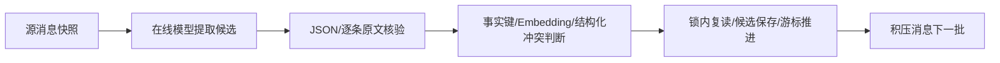
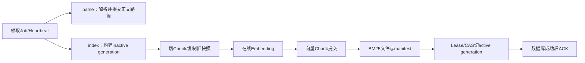

# LangGraph阶段6：记忆提取与知识索引后台图

2026-11-06，承接阶段5`b752ca2`。本阶段迁移两个后台链路：长期记忆候选提取，以及知识库文档解析/索引。图只组织阶段转换，Job、Outbox、Redis Stream、租约、数据库事实和提交后ACK仍由原业务基础设施负责。

## 记忆提取图

`MemoryCandidateWorker`领取一个持久化`MemoryExtractionJob`后进入：

源消息在图外先以ID、generation和摘要哈希冻结；模型只能看到脱敏数据。模型输出的`source_message_id`和`evidence_quote`随后由代码按用户原文核对，伪造的 assistant/网页证据直接丢弃，缺证据只能成为待审核候选。冲突服务先按事实键与范围筛选，再使用已配置的在线Embedding补相似记忆，最后让结构化模型区分duplicate/contradiction/complement/different_scope/uncertain。最终激活仍由原`MemoryService`代码在用户锁内复核版本、撤销记录和范围，模型没有授权能力。

图State只存Job ID、租约版本、阶段和候选数量，原文、密钥、完整模型输出、Session和ORM对象都放在本次Runtime或业务表。模型网络等待前没有数据库事务；后台Heartbeat每20秒检查90秒租约。租约被接管或数据库无法确认时取消旧模型任务，旧Worker不能保存候选或推进会话游标。合法完成后才调用原有`_complete`，候选、Job succeeded、游标在同一短事务中提交，随后处理新增积压；异常不把空数组当成“没有记忆”。

## 知识索引图

`KnowledgeJobWorker`仍由PostgreSQL Outbox发布到Redis Stream，Worker XREADGROUP后认领Job。Job图内部按类型路由：

索引图的Chunk准备阶段读取当前活动快照，复制未修改文档并生成目标文档的新Chunk；调用Embedding前结束数据库事务。向量校验通过后，完整Chunk在未激活generation中提交，BM25和manifest再生成，最后由原`KnowledgeJobCoordinator.activate_generation`检查Job租约、基础generation和manifest后切换`KnowledgeBase.active_index_generation`。任何解析、Embedding、BM25或manifest失败都不能覆盖旧活动generation；失败的inactive generation可审计并在后续清理。

ACK顺序没有交给图：成功或明确失败状态提交后，原Worker才XACK；租约丢失不ACK，Redis重复消息由数据库状态/幂等判断收口。图不把Redis消息当检查点，也不把检查点当业务事实。删除知识库时，仓储层同时删除其generation和只属于这些Job的Outbox事件，保留其他任务。

为避免提交后的ORM对象重新打开事务，`FrozenSettingService`现在只复制Embedding/Rerank地址等必要配置值；模型网络调用不依赖旧Session。原KnowledgeIndexService的同步入口继续保留给历史/单测，生产Job入口已走图。

## 文件与职责

| 文件 | 职责 |
| --- | --- |
| `backend/app/services/agent_graph/memory_extraction_graph.py` | 源快照、模型提取、证据核验、冲突、持久化和积压节点 |
| `backend/app/services/memory_candidate_runtime.py` | Worker领取/心跳/失败策略、脱敏快照、JSON校验、锁内保存；生产入口分派记忆图 |
| `backend/app/services/agent_graph/knowledge_index_graph.py` | parse/index两类Job图、Chunk/Embedding/向量/BM25阶段 |
| `backend/app/services/knowledge_job_runtime.py` | Outbox/Redis消费、Job租约、Heartbeat、生成激活CAS、ACK；冻结设置快照 |
| `backend/app/services/knowledge_index_service.py` | 拆出的生成快照、Embedding、向量提交和BM25 manifest业务动作 |
| `backend/app/repositories/knowledge_repo.py` | 删除知识库时清理generation与归属Outbox，避免孤儿索引 |
| `backend/tests/test_background_graphs.py` | 记忆图租约/秘密边界、索引图Embedding事务外、ACK/半成品/删除回归 |
| `scripts/memory_conflict_real_e2e.py` | 真实在线记忆冲突/Worker/浏览器审核/下一轮Chat；现在保留候选诊断字段用于失败排查 |
| `scripts/langgraph_phase6_knowledge_e2e.py` | 真实上传→解析→索引→活动generation→RAG回答/引用→浏览器，临时数据自动清理 |

## 验证

本地记忆相关133项、知识Job 8项、后台专项8项及全量后端1180项含真实PG/Redis通过；compileall、pip check、diff检查通过。完整全量运行没有跳过，日志中的超时/异常测试是既有故障收口用例，最终均按预期通过。

真实记忆冲突r3报告通过4个场景：补充、不同范围、重复、Worker后台矛盾提取后浏览器确认替换和下一次Chat使用新值；在线模型为DeepSeek-V3.2，用户设置不变，临时项目清理。r1在候选必须为pending/conflict的严格断言处失败，候选已经清理、无快照，原因尚未定位，不能归因为Worker竞争或宣称已修复。r2/r3后续通过；为下一次失败补充了不含正文的状态/关系诊断记录。失败批次保留，不把重跑成功当作原因定位。

真实知识库r1通过：临时Markdown上传，独立解析/索引Worker完成，活动generation为active且2个Chunk向量维度正确；相同请求复用原Job；在线模型回答包含“17天”和验收暗号并带`[KB]`引用，数据库消息和检索日志一致，知识库页面及Chat浏览器无错误，临时数据清理。

这些是真实流程和状态收口证据，不是大规模RAG准确率或线上容量结论。当前仍未把记忆/索引做成跨请求图检查点恢复；持久化Job、Artifact、generation和Redis消息仍是事实来源。阶段7再清理临时legacy入口，做完整对照、成本/延迟/故障统计和总迁移说明。
