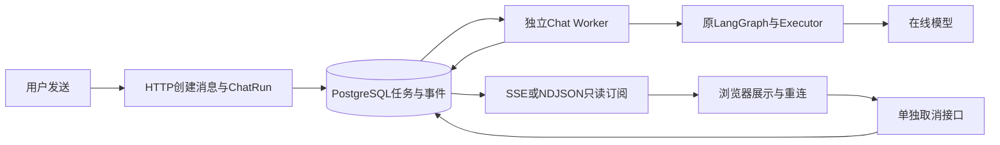

# 普通Chat独立任务、重连与统一取消

日期：2026-11-08。本文更新215中普通Chat随浏览器连接取消的边界；旧验收数字保留为历史，不算本次重新评测。

## 先看用户体验

用户发送问题，HTTP先把用户消息、assistant占位和ChatRun一起提交。独立的chat-worker领取任务，运行现有LangGraph上下文/工具/生成链，将回答片段与事件批量保存。浏览器只是读事件：关页面、断网或Next.js重启，不会向任务发送取消命令。

重新打开会话时，前端查询最近的Run：已完成的直接展示消息；仍在执行的通过SSE自动续订。用户点击停止，则发送独立POST取消请求；界面等待数据库终态，不把关闭连接伪装成任务已取消。

## 实现分工

| 文件 | 具体职责 |
| --- | --- |
| `backend/app/models/chat_run.py` | ChatRun保存归属、生成版本、执行阶段、增量正文、租约、时限和终态；ChatRunEvent按Run内单调序号保存可重放事件 |
| `backend/app/services/chat_run_service.py` | 创建/幂等/配额/领取/续租/提交/取消/过期/清理；Run、正文消息与事件在短事务内一起提交 |
| `backend/app/services/chat_run_worker.py` | 独立消费任务，复用ChatExecutionService、上下文图与生成图；批量保存，心跳监测，停止与异常收口 |
| `backend/app/services/runtime_lease.py` | Chat与Durable共享租约判断；提供可取消的心跳等待，不代替数据库锁 |
| `backend/app/services/chat_run_guard.py`、`tools/executor.py` | 将当前Run执行权传到工具子图，工具执行前、适配器返回后重查；失权抛控制异常，禁止进入普通工具失败兜底继续运行 |
| `backend/app/api/routes/chat_runs.py` | 创建、重生成、编辑重答、快照、会话最近Run、取消、事件分页订阅；始终验证用户与会话归属 |
| `backend/app/api/routes/chat.py` | 原POST流改成创建任务后订阅的兼容入口，不在路由中调用模型 |
| `backend/app/services/chat_stream_service.py` | 统一Provider事件、超时、引用审计和终态回调；Worker直接消费异步迭代器，不依赖HTTP路由或响应连接 |
| `frontend/src/lib/chat-run-events.ts` | SSE跨包解析、游标去重、有限订阅重连；只重试读取，不重发任务 |
| `frontend/src/components/chat-thread.tsx` | 自动恢复活跃Run、真实取消命令；断网不虚构failed/cancelled；保持工具/来源/引用展示 |
| `backend/scripts/run_chat_worker.py`、`deploy/supervisord.conf` | 唯一独立Chat进程，Provider池、审批池和信号退出；不在Web create_task运行生成 |

现有模型、RAG、长期记忆、上下文预算、Tool DAG、安全校验与文件审批没有被换掉。Chat使用专门任务表，不将消息伪装成AgentStep。复用配额锁、租约判断、Worker注册/健康基础、Provider池及业务图；Chat事件机制仍是专用的。

## 状态与取消裁决

| 场景 | Run状态与行为 | assistant消息 |
| --- | --- | --- |
| 等待Worker | queued | streaming占位，前端等待事件 |
| Worker准备/生成 | running，phase为prepare/generate | 按批次更新streaming正文 |
| 用户停止排队任务 | 直接cancelled，不调用模型 | cancelled |
| 用户停止执行中任务 | cancel_requested；Worker心跳发现后取消本地生成，终态cancelled | 确认前仍streaming，确认后cancelled |
| 正常完成 | succeeded | done |
| Provider/准备失败 | failed，公开错误码与部分结果 | failed |
| 排队或执行超时 | expired | failed |
| Worker强退、失租约或进程停机 | interrupted，保留已提交片段 | failed |

取消和完成在数据库Run行锁内裁决：完成先提交，后来停止只返回已完成；取消先提交，迟到完成不能变回成功，也不能追加取消后的正文。事件和Message同事务更新，避免前端收到done但数据库仍streaming。普通Chat的generation CAS继续有效；旧Worker必须核验数据库当前owner、version、expiry，不能只比较内存ORM。

HTTP取消与模型停止是两回事。Worker尝试关闭可取消的Provider流；已经发到第三方的请求、已经提交的合法文件改写不保证撤销。不能取消的外部调用，返回后仍需执行权检查，禁止解锁下一步或提交迟到结果。系统不自动写反向补丁，以免覆盖用户后来修改；需要按真实副作用人工处理。已有审批不是安装或订阅赋予的权限。

## 事件、API与成本边界

| API | 含义 |
| --- | --- |
| POST `/api/chat/runs` | 创建并返回202及run_id，支持client_request_id；同标识同输入复用，异输入409 |
| POST `/api/chat/runs/regenerate`、`/edit` | 与原消息重置/编辑及generation切换一起创建新Run |
| GET `/api/chat/runs?conversation_id=...` | 当前用户该会话最近Run |
| GET `/api/chat/runs/{id}` | 任务快照、部分/完整正文、阶段、事件游标和公开错误码 |
| POST `/api/chat/runs/{id}/cancel` | 幂等取消命令，不通过断开订阅代替 |
| GET `/api/chat/runs/{id}/events` | 默认SSE，支持after或Last-Event-ID（run_id:sequence）；format=ndjson保留兼容 |

当前首次发送仍兼容原NDJSON代理与事件UI；重开会话使用SSE续订。两者均只读同一份持久化事件，不是两套生成。游标已到终态末尾仍返回快照；事件过期则用当前快照重置，不凭空重新生成。

默认排队5分钟、整次执行15分钟（含工具准备和最终回答）、最终回答最多8192Token、回答与reasoning合计20万字符、每Run事件8MiB。用户未完成Run上限2，全局运行上限16，单Worker并发4。浏览器订阅另有用户级租约，默认最多4个读连接，断开只释放读额度。现有输入窗口/工具预算继续适用。Provider底层请求可有原来的连接/有限请求重试；本次不做整个Chat或已开始工具流程的自动重跑。

OpenAI-compatible Provider的结束原因单独记录；明确`length`时收口failed/output_token_limit，保存部分回答，不能将额度截断当作完整成功。Ollama流传入num_predict并转发done_reason，只有模拟HTTP验证，没有加载本地模型。未报告结束原因的兼容Provider不具备相同的截断诊断证据，不能只凭EOF保证语义回答完整。

短片段约150ms或累计512字符触发持久化，不按每个Token执行一次SQL。进程强退可能丢失未提交批次；用户取消后保留取消前已提交内容。事件默认保存7天，Worker按批次清理终态Run的旧事件，Run/消息快照继续保留，删除会话/消息级联清理。全部Worker停止时，定时过期巡检也暂停，应根据独立健康探针恢复Worker或主动取消，不宣传无需运行组件的自动修复。

## 恢复能力的准确边界

浏览器断开只丢失订阅，Worker还活着就能继续完成，这是本次新增能力。Worker真正崩溃则是另一种情况：租约过期后标interrupted，不透明重试上下文和模型，也不从半截Token继续。用户可明确重新生成，创建新generation/Run，旧Run仍可追溯。

普通Chat内部仍使用无原生Checkpointer的LangGraph，通过ChatRun阶段、消息和事件保存业务事实。已有低风险Durable/审批/文档的PG原生检查点机制保留，不把本次Chat阶段快照等同于可以任意恢复模型循环。后台继续生成意味着用户离开也可能计费，执行上限与配额负责限制这部分成本。

## 验收记录

真实验收首批 `backend/evals/results/chat-run-real-20261108-r1.json`：在线DeepSeek-V3.2，浏览器收到153个cl100k估算Token、827字符时彻底关闭，Worker继续生成至2261字符并正常结束；重开浏览器展示全文，Message与Run正文一致，最终生成逻辑尝试为1（不代表统计了全部Planner/SDK底层HTTP次数）。活跃任务SSE恢复/真实停止/重复停止通过；取消后同会话新发，真实文件搜索与读取、最终答案、尾游标重放通过；浏览器错误0。该验收只检查运行可靠性，不评分模型是否满足长文语义或全部格式要求。

真实PG专项覆盖并发重复创建、多个Worker领取、取消完成竞争、子进程提交片段后os._exit、旧版本拒绝、排队过期、输出/全局配额与事件清理。初次新增过期用例失败，原因是autoflush关闭时对账状态尚未进入SQL，领取查询看到了旧queued；已加flush，修复后通过，不跳过该用例。全量首轮另有旧HTTP配额测试仍在等请求内prepare，已改为验证后台Run配额，保留原失败日志。最终全量、部署及GitHub结果在收尾时补充，不用专项通过代替完整回归。

中间回归记录：full-r1的1214项因旧HTTP配额测试报错；full-r2的1227项及full-final的1228项因运维测试夹具未增加chat-worker失败，夹具已按真实托管角色更新。最初100ms限时测试在并发测试负载下可能还没首Token就超时，改为先确认已保存片段，再设置真实数据库截止时间，仍要求终态expired/正文保留/无重试，没有延长生产限额。最终本地full-verified为1228项全部通过，包含真实PG/Redis；之后Provider结束原因与输出限额的65项定向和1项Ollama模拟通过，前端lint/build及Node4项通过。最终代码的完整CI结果另记。

在线浏览器r3严格结尾标记检查失败，Run为succeeded，但诊断在清理前未保存最终正文和结束原因，因此不能事后断言为Token截断或模型漏写。原failed报告保留；后续脚本先保存正文/Token/finish_reason再断言，并单独测页面实际可见Token数。r1/r2的Token数来自已提交正文，不冒充精确的浏览器显示计数；最终严格浏览器批次另记。

最终严格浏览器r4通过：页面实际显示146个cl100k估算Token时关闭（当时数据库155Token/842字符），再重启Web；独立Worker继续完成17,288字符，Provider报告stop、输出3834Token、上限8192，结尾标记也存在。新浏览器全文可见，Message与Run一致，最终生成逻辑尝试1；SSE活跃重连/停止/重复停止及取消后同会话文件工具/答案/尾游标全部通过，浏览器错误0。报告为`chat-run-real-20261108-r4.json`及两张截图，原r3失败不改分、不声称其根因已定位。

共享生成服务抽出及异步兼容路由独立Session后的69项定向通过，其中23项真实PG；Provider专项及Ollama模拟另通过。最终部署的短回答NDJSON→独立Worker→Run快照→SSE尾游标再验见`chat-run-http-final-20261108.json`。没有重跑历史200业务题或RAG百题，不借用其分数描述本次Chat改造。

## 部署和回退

显式迁移版本20261108_01新增chat_runs/chat_run_events；DDL固定，不在启动时建表。迁移前暂停本项目写入者，备份到仓库外`/disk2/gengnan/aiws-backups/20261108-chat-run-01`，再升级并恢复唯一服务。当前API32007、前端32008、PG35433、Redis36379不变，新增单一Supervisor角色chat-worker。

`/health/ready`检查Web依赖，`/health/workers`分别检查Durable和Chat Worker心跳，不能由某一角色掩盖另一角色停止；`deploy/check_services.py`纳入Chat进程，备份脚本也暂停Chat写入者。回退应用前先停止并处理未完成ChatRun，避免旧应用误清理新任务；保留新表/迁移链，不盲目downgrade删除运行记录。必要时成套恢复备份，需要明确处理备份后的新增数据。
