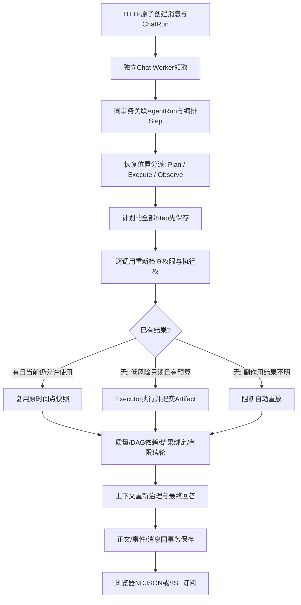

# Chat与工具统一持久化恢复

日期：2026-11-08。继216之后的实现更新；216中的“不自动重新生成/工具图无持久化恢复”为本轮之前的边界，原测试记录保留。

## 用户现在得到什么

普通问答仍是同一个入口。浏览器关闭只停止订阅，后台继续执行；用户主动停止才取消任务。现在Chat Worker进程意外退出后，也能在有限次数内被接管。已提交的工具结果不重做；未完成的低风险只读调用在预算内重试；等待审批或结果不明的写入不能自动重发。

最终模型输出中途崩溃时，重新生成这一阶段，而不是接着半截Token往下写。旧片段保存为内部恢复产物，新回答开始前发送空正文快照，NDJSON/SSE界面替换旧展示。最终消息只保存新一轮完整正文；先前事件保留为记录。

## 统一了哪些基础，哪些仍分开

| 层 | 当前职责 |
|---|---|
| ChatRun | 排队、领取、取消、回答片段、事件游标、生成尝试数和最终消息 |
| AgentRun | `runtime_kind=chat_tool_workflow`，以唯一`chat_run_id`关联父ChatRun |
| AgentStep | `sequence=0`为工具循环编排记录，不是外部工具；其余为计划调用，包括未真正执行的依赖阻断步骤 |
| AgentArtifact | 保存脱敏后的工具响应；中断回答归档为`chat_generation_partial`，两者均不进入正式交付物工具列表 |
| AgentCheckpoint | 工具循环的业务进度：下一节点、计划、观察、账本和预算；正文仅在受保护业务表，不放进原生图State |
| 原生PG检查点 | 复用`aiws_graph`、连接池、thread清理和Fencing Saver基础；Chat图写入检查父Chat的owner/version/expiry/generation和范围 |

普通Chat不是把全部步骤丢给现有固定计划的Durable Worker。Chat Worker继续负责动态规划和流式回答，Durable Worker继续执行用户确认的后台固定计划和文档任务；两者共享Agent表、检查点基础与执行器，调度配额及产品入口分开。知识索引仍使用Outbox/Redis Stream；这次没有改变它。

新租约从业务已提交位置重新分派图。检查点可能落后于结果事务，因此优先检查Step/Artifact，不能照旧`next`盲目重做外部操作。图写入采用同步持久化，State只保存节点名和计数，不存认证配置、客户端、Session或原始工具正文。

## 故障与预算

| 场景 | 当前行为 |
|---|---|
| A完成、B进行中退出 | 新Worker复用A；B在允许范围内重新执行 |
| Artifact提交后、节点检查点前退出 | 检查业务结果，仍复用已提交产物 |
| 规划请求进行中退出 | 保存已消耗轮次和截止时间；允许有限次重新规划，不宣称模型请求只发一次 |
| 生成进行中退出 | 已保存前缀归档，最多再生成一次；可能多付一次模型费用 |
| 到期、用户取消、generation改变 | 停止推进；旧Worker不能写结果或图记录 |
| 工具/Skill版本、启用状态、文件范围改变 | 恢复复核失败，不能继续使用旧计划或旧证据 |
| 写入已请求但结果不明 | 阻断自动重放；换call_id也不能绕过；原审批和Revision CAS仍是写入依据 |
| 工具阶段预算已耗尽 | 不追加请求，保留已提交有效证据做部分回答 |

最多三次Worker领取、两次最终生成，不重置第一次领取时的900秒总截止时间。工具阶段以绝对截止时间恢复，进程离线和等待接管也占用工具时长；原quick_chat/guided_research/workspace_review/edit_proposal的轮次与上限不增加。进入执行器的尝试以PG Step计数，包含执行前校验和崩溃前已开始的调用，不代表实际HTTP请求数或计费次数；复用结果不再增加尝试。每次最终生成仍受原输出上限约束，最坏可能发生两次生成，不能把单次8192Token宣传成两次合计8192。

普通UI使用NDJSON或SSE，可处理重置。旧纯文本接口没有替换事件：遇到重新生成时结束旧文本订阅，最终完整答案通过Run快照/消息读取，不能把新回答直接接到旧文本后。

## 文件地图

| 文件 | 负责什么 |
|---|---|
| `app/services/chat_tool_runtime.py` | 短事务绑定父Run、保存计划/节点进度、逐调用提交/复用、范围复核与结果不明写入阻断 |
| `app/services/tools/runtime_codec.py` | 显式类型白名单JSON编码、嵌套脱敏，拒绝任意对象反序列化 |
| `app/services/agent_graph/sync_tool_graph.py` | 依据业务位置进入Plan/Execute/Observe/Finalize，并接原生PG Saver |
| `app/services/chat_tool_checkpoint.py` | 在原生检查点写事务中复核父Chat执行权与用户/项目/generation |
| `app/services/durable_checkpoint_service.py` | 原生PG连接池与Saver公共基础，原Durable默认行为保留 |
| `app/services/tools/executor.py` | 正常校验和Adapter前后接逐调用持久化；内部非Chat调用继续使用原执行器 |
| `app/services/tools/loop_runtime.py` | 保存规划请求前的消耗，恢复后按实际工具尝试计算预算 |
| `app/services/chat_run_service.py` | 原子领取与建立关联、失租约重排、有限生成、旧片段归档和快照重置 |
| `app/services/chat_run_worker.py` | 在独立进程注入本次运行上下文，沿用心跳/取消和Provider生命周期 |
| `app/api/routes/agent_runtime.py` | 可读运行详情；Chat恢复正文不作为普通检查点详情回显 |
| `frontend/src/components/chat-thread.tsx` | NDJSON/SSE快照替换，绝不把两次生成拼接 |
| `frontend/src/components/tool-trace-panel.tsx` | 显示结果复用和持久化步骤；按需查询步骤状态与实际尝试次数 |

后端路径相对`backend/`。`AgentRun.status=succeeded`在Chat工具运行中表示循环已经收口，具体业务是否部分完成、等待审批看`planner_state.workflow_status/next_action`和每个Step的质量/执行状态，不能用它冒充任务100%完成。

## 验证记录

最终后端全量1269项通过、无跳过（含真实PG/Redis）；新增恢复专项38项（SQLite 17、真实PG 21），包含`os._exit`窗口、Result Binding、多轮预算、并发分支独立提交、取消迟到结果、工具撤销、文件删除、依赖阻断Step、写入不明与换call_id、生成重置和最大领取次数。前端lint/build及5项Node测试通过；compileall和diff检查通过。测试集合有重叠，不能把全量与专项相加。

在线模型验收报告：`backend/evals/results/chat-tool-recovery-real-20261108-r1.json`及后续批次。r1中真实工具恢复通过；最终生成已在后台完成，但页面原始文本比较断言失败，未保存该次DOM明细，不能追溯改成通过。后续脚本先保存DOM/复制原文，再用真实“复制回答”核对前端持有内容，避免Markdown排版与原文混为同一指标。

最终在线r2的两个场景通过：真实搜索提交后进程退出，正式Worker等待实际45秒租约到期后接管，搜索仍1次尝试，继续文件读取并完成177字符回答；浏览器看到717字符后KILL唯一ChatWorker，自动拉起，旧生成归档804字符，新一轮完整8962字符。快照重置1次，前端复制原文与DB严格一致，最终生成2次、浏览器错误0。报告`chat-tool-recovery-real-20261108-r2.json`及同名前缀截图只包含临时会话。

真实审批回归`chat-tool-approval-ui-final-20261108.json`通过：只读Diff不写、真实界面查看持久化步骤、正式审批前文件不变，确认后Approval=consumed/版本1→2，重复确认不增加版本，新会话真实读取新标题与17天原事实，刷新仍保留，浏览器错误0。首轮测试因“查看”按钮改名“刷新”后动态定位失效而失败，`chat-tool-approval-ui-20261108-r1.json`保留；改用稳定父面板定位后重新测试，不改变通过标准。最终部署HTTP冒烟`chat-tool-recovery-http-final-20261108.json`验证旧NDJSON→Worker→答案→SSE尾快照通过。

早期测试还定位并修复：指纹展示前缀超过64字符列、会话删除的级联触发顺序、SQLite并发短写入、PG夹具无外键配置表未清理以及超时误收口为interrupted。失败批次日志保留在本机`/tmp/aiws-chat-tools-*`；最终数据见对应通过报告，不把早期失败隐藏为零失败全过程。

这些是恢复与业务冒烟，不是重跑200题Agent评测、RAG评测或线上容量测试。

## 部署与回退

仓库外备份：`/disk2/gengnan/aiws-backups/20261108-chat-tools-recovery-02`。先完成备份再执行显式迁移：20261108_02新增唯一父ChatRun关联及级联，20261108_03把既有Agent会话/消息外键校验推迟到事务末，消除双重引用的级联触发顺序问题；提交时仍拒绝悬空引用。新旧迁移分开保留，不篡改已经执行的版本。

只保留原Supervisor单套Web/前端和四类Worker；Chat Worker启动复用原生检查点池。备份已完成，但备份脚本尝试恢复新代码时遇到尚未升级的schema而返回错误；随后显式升级和服务恢复已完成，不能把这个CLI退出码写成“备份从未成功”。

回退前停止领取并收口活跃任务，使用匹配代码/结构的备份在隔离目标恢复验证，不对运行库直接覆盖。旧代码并不认识新恢复阶段，不能只checkout旧代码就称完成回退。

## 保留边界

不支持原样续Token，不承诺外部请求exactly-once。只有执行结果已提交才可保证不重做；只读请求发出后、结果提交前退出仍可能重发。恢复时重新组装当前获准的RAG/记忆/上下文，不把旧工具结果当成重新查询的实时事实。审批、Shell/SQL/任意主机写入与脚本沙箱范围均未扩大；学习进度仍为Day28补强。
