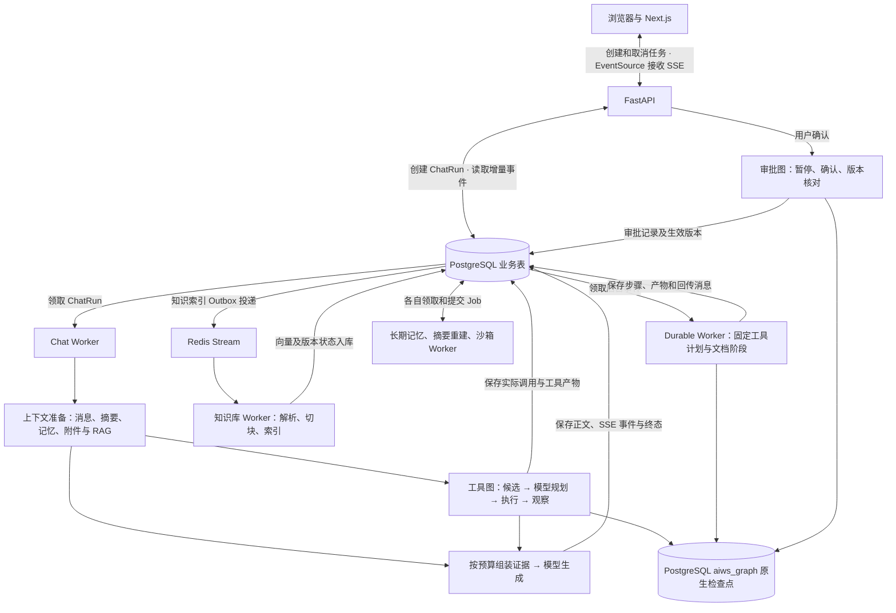

# 当前系统架构与运行时复查

图按职责简化了上下文准备，具体顺序见 [`context_graph.py`](../backend/app/services/agent_graph/context_graph.py)。知识库检索按配置使用关键词、向量及融合重排；上传原件和索引文件等数据存受管文件系统。通用 Python 沙箱仅运行用户批准的离线代码，结果由沙箱任务独立查询。

## 一条 Chat 怎么跑

FastAPI 创建 ChatRun 和消息占位后返回 ID；浏览器建立独立的 SSE 订阅。Chat Worker 领取任务，准备上下文，再按预算把最终证据交给模型。正文、事件和终态写入 PostgreSQL 后，SSE 才把已保存事件送给浏览器。关页面只断开订阅；主动取消使用独立接口。

工具循环由 LangGraph 编排。代码筛候选，模型输出工具计划，代码检查权限及参数、按依赖执行、评估结果质量。Worker 接管时从原生检查点恢复计划、预算和节点位置，再核验当前权限和已提交产物。已完成的工具结果可以复用；最终回答中断后支持有界重新生成。

| 要恢复或查询什么 | 数据来源 |
| --- | --- |
| 工具和审批从哪一步继续 | `aiws_graph`：Chat 工具循环、Durable 工具步骤、文档步骤及审批图的原生检查点 |
| 谁能执行、执行过什么、用户拿到什么 | PostgreSQL Run、Step、Artifact、Approval、文件版本和业务审计 |
| 浏览器断线后展示哪些片段 | PostgreSQL ChatRun、正式消息及 SSE 事件日志 |
| 知识索引任务如何投递 | PostgreSQL Job/Outbox + Redis Stream；Chat 和固定 Durable 工具任务不消费这条 Stream |

## 本轮复查

- **旧文件证据**：[`chat_tool_runtime.py`](../backend/app/services/chat_tool_runtime.py) 用原有的文件内容摘要核对已保存的工作区读取结果。文件改动或不再属于原工作区时，拒绝用旧正文接管，不自动重跑旧计划。
- **错误归类**：[`chat_run_worker.py`](../backend/app/services/chat_run_worker.py) 和 [`chat_run_service.py`](../backend/app/services/chat_run_service.py) 区分工具恢复不可用、本地保存预算耗尽和通用失败；数据库与 SSE 使用对应错误码，不暴露内部异常。
- **业务审计**：任务详情和 [`durable_audit_service.py`](../backend/app/services/durable_audit_service.py) 导出共用事件名称投影，保留历史 `event` 和当前 `type`，排除详情正文。
- **旧代码**：清理无调用的旧附件拼接、旧摘要生成/写入、工具汇总包装以及重复结果序列化。现用证据裁剪和滚动摘要回退不受影响，保留历史迁移和评测证据。

扩大 Worker 并发前，建议单独观察检查点池的等待和连接持有时间。Saver 可在多个图节点间复用同一物理连接，虽然外部请求期间无需持续持有业务事务，连接仍可能占用池。本轮未调整池参数。

验证：涉及 Chat、工具工作流、审计、审批与上下文的 168 项回归通过；补丁最后一次提交到测试时又用真实 PostgreSQL 跑了 ChatRun 和工具恢复 52 项，覆盖「读取完成后修改文件、接管拒用旧证据」。两组有重叠，不相加。本轮没有改数据库迁移或重新部署服务。
