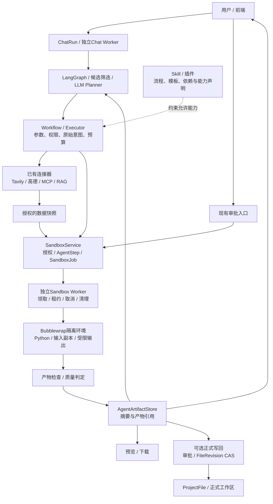

# Introduction

本文是**待实施架构**，不是新增功能验收报告。已实现的限定审核脚本见[235](../docs/235_Bubblewrap离线审核脚本沙箱_2026-11-17.md)。本轮只设计与核对代码，不开放新权限、不运行任意代码。

目标：沙箱成为通用受限计算环境，承接数据处理、数值计算、内容转换、规则验证、图表及交付物生成。不同业务复用少量执行入口，不再逐项注册脚本。项目仍是个人/小团队知识工作台，不建设任意主机操作平台。

**分工**：模型和LangGraph决定下一步；Executor检查允许做什么；Sandbox Worker管理执行；Bubblewrap隔离代码；后端检查结果并负责正式提交。

## 当前与目标

| 层面 | 当前代码 | 目标，尚未实现 |
| --- | --- | --- |
| 入口 | 插件中心预览/确认，SCRIPTS仅document_inventory | 一个sandbox.python.execute通用Tool，插件/Skill/Chat共用 |
| 代码 | 仓库审核脚本 | 审核脚本及本次用户/模型生成代码；生成代码仍需授权和隔离 |
| 环境 | 系统Python3.8、离线、单进程、只读、stdout产物 | 维护中的Python3.12只读运行时，先离线/单进程，再分步扩展 |
| 输入 | 授权ProjectFile正文副本 | 文件、RAG片段、工具结果及Artifact的显式授权快照 |
| 输出 | Markdown/JSON，存在SandboxJob | 结构化结果与文件引用，接AgentArtifactStore |
| 编辑 | 后端Diff/Approval/FileRevision CAS | 隔离副本上计算修改，后端仍提交正式版本 |
| 恢复 | 独立Job租约，未接通Chat工具恢复 | 关联既有Step，等待/恢复父任务，复用已提交结果 |
| 联网/依赖 | Bubblewrap拒绝 | 先连接器取数，后续代理与审核运行时；默认关闭 |

## 架构与执行位置

图中是目标连接，不代表当前全部接通。Worker是可信管理进程，可通过业务服务访问数据库；**被执行代码在Bubblewrap子进程，拿不到数据库、Redis、模型/MCP密钥及管理接口**。不把Web、数据库和整个项目塞入一个沙箱。

## 不止文件：能力路由

| 任务 | 执行方式 | 开放顺序 |
| --- | --- | --- |
| 问答、RAG、记忆提取 | 保留现有服务；不为模型请求启动沙箱 | 已有，不迁移 |
| 联网研究、地图、远端MCP | 连接器持有凭据，结果按需复制给沙箱 | 连接器已有，输入桥接待做 |
| CSV/JSON清洗、玩家反馈汇总、数值统计、规则验证 | 同一个Python Tool处理不同代码与输入 | 通用离线计算 |
| 多来源结果合并、抽取结果一致性检查 | Python计算，保留证据来源；模型提取与确定性计算分开 | 通用离线计算 |
| 图表、Word、批量格式转换 | 经验证的运行时/依赖及可写临时空间 | 文件产物阶段 |
| 文件改写 | 在指定版本副本上计算结果，后端审批/CAS提交 | 编辑桥接阶段 |
| 本次程序测试、解析逻辑校验 | 无子进程的Python断言；不是执行仓库任意命令 | 通用离线计算 |
| 浏览器自动化 | 如有明确需求，另设Browser执行配置；现有单进程配置不能运行浏览器 | 本计划不实现 |
| Shell、宿主SQL、删除文件、支付、邮件、发布 | 不因“通用执行”隐式加入Catalog | 不实施 |

**例子一，玩家反馈统计**：用户授权CSV和口径 → Planner提交计算代码 → 后端核实项目范围并展示代码/权限 → Worker隔离计算类别数量与重复反馈 → 检查表格和产物 → 模型解释结果 → 下载报告。分类需要LLM时先由模型服务分类，脚本不获得模型Key。

**例子二，资料研究与修改**：RAG/网页工具取证 → 选中片段和来源ID进入沙箱合并/核算 → 模型起草 → 沙箱在文件版本副本上计算替换结果 → 后端重算Diff/PatchDraft → 用户批准或项目已有授权 → CAS保存。下载独立产物不等待“覆盖原文件”审批。

## 1. Requirements & Constraints

- **REQ-001**: 注册sandbox.python.execute作为通用计算入口。统计、整理等不是新的沙箱类型。查询/取消使用任务资源接口，不让Planner反复轮询消耗工具轮次。
- **REQ-002**: 请求只接收code、input_refs、runtime_profile、expected_outputs与任务说明；用户、项目、父Run/Step由服务端注入。不接受宿主路径、启动命令、挂载或提权参数。
- **REQ-003**: input_refs引用已授权ProjectFile/FileRevision、RAG片段或Artifact，服务端解析并复制指定内容；不自动搬整个知识库、对话历史或目录。记录实际来源及版本。
- **REQ-004**: 复用ChatRun/AgentRun/AgentStep、AgentApproval、AgentArtifactStore、FileRevision和ToolInvocationRuntime。SandboxJob只记录一个Step的隔离执行，不另建Agent规划系统。
- **REQ-005**: Chat现已是独立Worker+SSE；接入沙箱要持久等待、释放执行资源、完成后恢复。浏览器断线不取消，主动停止传播到子Job。
- **REQ-006**: exit code=0不等于完成。结构、要求的列/文件及业务目标仍经质量和完成检查；入队不能解锁依赖，缺报告不能标完成。
- **REQ-007**: 沙箱只生成结果/提案。创建正式文件或覆盖旧版本由DocumentDeliveryService/AgentRuntimeService检查权限和提交，不让子进程直接访问正式存储。
- **REQ-008**: 每次执行创建新的隔离进程，不持久保存Python内存。跨步骤使用Artifact，崩溃不续半截代码；仅离线、无正式副作用且无已提交产物的任务，重新核验授权后最多执行2次，超时/脚本错误不自动重试。修改代码需要新Step和新授权，不能篡改正在执行的Job。
- **REQ-009**: 阶段3的文件先在受控临时区收集/检查，再进入正式产物存储并提交数据库引用；文件系统与PG不共用事务。崩溃可能留下孤立文件，需按Job/Step归属清理；数据库未确认可见前不得交给下游，不能仅凭文件存在断言成功。
- **SEC-001**: 不继承Worker环境、宿主目录、管理接口、数据库连接、Redis、Provider/MCP密钥或Docker socket；脚本不能自行声明已批准或已正式写入。
- **SEC-002**: 有效权限取项目策略、工具启用、Skill/插件能力、本次授权、后端实际支持的交集。模型、Skill和外部资料不能增加权限。
- **SEC-003**: 保留read_only/ask/full_workspace：read_only默认不开放通用执行；ask展示代码、输入与副作用后确认；full_workspace也需另外启用sandbox.python.execute，才能自动执行项目内离线计算，不自动开放网络/依赖/任意路径写入。
- **SEC-004**: 生成代码不是审核代码。开放通用入口前部署维护中的只读Python3.12，不将过期系统Python3.8作为对外通用执行环境；静态代码检查不能替代隔离。
- **SEC-005**: 首次通用执行保持无网络、无进程/线程创建、无exec、无pip。依赖来自审核的只读运行时，不为兼容性批量放开系统调用。
- **SEC-006**: 可写目录必须限制总字节和inode。RLIMIT_FSIZE只限单文件，RLIMIT_AS不限制tmpfs总量。本机bwrap0.4.0无--size，不能把无界--tmpfs或普通宿主目录当成有配额临时空间。
- **SEC-007**: 首期沿用受限stdout发布产物，不依赖可写目录。固定256MiB地址空间、45秒墙钟/CPU累计、单进程、12份输入/8MiB总输入、1MiB合计输出、16份产物、64KiB代码。Worker串行、全局并发1、单用户并发1；扩容另测。
- **SEC-008**: 网络先由既有连接器取数；后续Broker只执行预览批准的HTTPS GET request_id，不接受任意URL/参数/请求体。复用连接级IP验证、TLS、重定向检查；10秒超时、单次4MiB、每Job最多5次。新目标/外发内容回父图重新授权，不挂着进程等用户。
- **SEC-009**: 文件产物检查实际类型、路径、符号链接、数量、大小与压缩展开。HTML/SVG默认作附件，不能同源执行。正文作为数据，不接受其权限指令。
- **CON-001**: 共享内核、无委派cgroup/独立系统账号，不承诺可安全接收公网攻击者代码。通用执行首批限已知用户/项目；更强隔离需要更换执行后端，不放宽宿主策略。
- **CON-002**: 不改数据库和服务端口，不启动Ollama，不改账号Provider，不新增同职责Screen；本设计阶段不改变运行权限。
- **PAT-001**: 复用短事务、行锁/CAS、已有参数摘要和幂等键，不新增并行hash/冻结协议。同一Step唯一绑定Job；重试保留Job并递增已有执行版本，不能替换授权后的代码/输入。
- **GUD-001**: 文档/UI明确已实现与计划；预检通过、Job入队和进程结束不能当业务验收。

## 2. Implementation Steps

### Implementation Phase 1

- **GOAL-001**: 通用离线协议与维护中的运行时，通过受限文本/JSON产物完成多类业务。

| Task | Description | Completed | Date |
| --- | --- | --- | --- |
| TASK-001 | 新增backend/app/schemas/sandbox.py中的SandboxExecutionCreate和输入引用类型；SandboxService.preview_execution()解析REQ-003的授权引用，不接受宿主路径；代码64KiB。 | 否 | 未执行 |
| TASK-002 | 修改backend/app/models/plugin.py：SandboxJob增加agent_step_id唯一可空关联及entrypoint_kind；plugin_key/release_id/script_key允许通用内置任务为空。新增backend/migrations/versions/20261117_01_沙箱步骤关联.py显式迁移；旧Job保留原授权，不自动升级。 | 否 | 未执行 |
| TASK-003 | 新增backend/sandbox/python_runtime.py，预检只读Python3.12；bwrap_runner.py新增execute_code()并复用隔离底座，不能直接把_run_source暴露为Web任意执行。缺运行时拒绝执行。 | 否 | 未执行 |
| TASK-004 | sandbox_service.py/sandbox_policy.py统一授权检查，复用AgentApproval和现有arguments_hash绑定本次代码/输入/配置；扩展api/routes/agent_runtime.py批准分发，旧插件入口复用服务，不分叉审批逻辑。 | 否 | 未执行 |
| TASK-005 | 新增backend/tests/test_sandbox_execution.py：12个固定业务覆盖JSON变换、CSV清洗、去重、数值聚合、规则断言、证据合并；业务变更不新增SCRIPTS注册，另测跨用户/改代码/无审批拒绝。 | 否 | 未执行 |

依赖：TASK-001/002/003可独立准备，TASK-004依赖三者，TASK-005依赖TASK-004。完成标准：一个通用入口完成六类业务，权限/资源验证通过；旧清单可运行，运行时不满足则不开放生成代码。

### Implementation Phase 2

- **GOAL-002**: 接入Tool、Chat与恢复，结果进入统一Artifact，不靠用户反复刷新推动流程。

| Task | Description | Completed | Date |
| --- | --- | --- | --- |
| TASK-006 | backend/app/tool_manifests/default_tools.json增加sandbox.python.execute，sandbox adapter、read_only=false、专用授权；tools/adapters.py分发到新增providers/sandbox.py。筛选/Planner只使用这一个Schema。 | 否 | 未执行 |
| TASK-007 | sandbox_service.py实现submit_for_step()：Chat复用现有AgentRun/Step；插件独立提交才建立runtime_kind=sandbox_workflow的Run/Step。旧低风险只读Durable入口继续拒绝该Tool，不能假装只读绕过。 | 否 | 未执行 |
| TASK-008 | tools/schemas.py、tool_invocation_runtime.py、chat_tool_runtime.py和agent_graph/sync_tool_graph.py新增受控等待语义与waiting_sandbox Step状态；回执不标成功/失败、不解锁依赖，保存等待Job及并行批次关系。 | 否 | 未执行 |
| TASK-009 | ChatRunService增加pause_for_sandbox()/resume_after_sandbox()，ChatRunWorker显式挂起并释放执行租约/连接；活跃配额、取消、超时、恢复、前端状态均覆盖waiting_sandbox。绝对deadline、已用工具预算不重置；不得用新预算掩盖原墙钟耗尽。 | 否 | 未执行 |
| TASK-010 | 新增sandbox_result_service.py：Worker短事务锁Job/父Step，检查版本、父代际、取消、当前授权，检查产物后通过AgentArtifactStore保存并收口Step；当前并行批次全终态才恢复父任务进入Observe。Job结果/Artifact引用/父状态同PG事务提交，重复通知不重复产物；二进制阶段按REQ-009处理存储窗口。 | 否 | 未执行 |
| TASK-011 | 新增frontend/src/components/sandbox-task-card.tsx，ToolTracePanel展示等待/运行/取消/产物，复用ChatRun SSE；插件独立任务查Job资源。quality.py/completion_verifier.py只看真实结果，不把入队当完成。 | 否 | 未执行 |

依赖阶段1，先TASK-006/007，再TASK-008/009，TASK-010依赖等待模型，最后TASK-011。完成标准：真实模型规划→关页→沙箱完成→父任务恢复并回答；主动取消、重复提交、跨代际迟到结果、并行一支失败验证。

### Implementation Phase 3

- **GOAL-003**: 资源边界可验证后开放临时文件、二进制产物及编辑预览，不直接覆盖工作区。

| Task | Description | Completed | Date |
| --- | --- | --- | --- |
| TASK-012 | scripts/probe_sandbox_environment.py增加总量/inode限制探测，独立评估非setuid新版bwrap有界tmpfs；实际超限会拒绝才开放writable配置，做不到保留受限输出，不用无界目录兜底。 | 否 | 未执行 |
| TASK-013 | bwrap_runner.py支持/input只读、/work与/output临时可写；两个可写挂载各32MiB/512 inode，单产物8MiB、16份以内/合计16MiB；collector用FD且不跟随链接收集普通文件。依赖TASK-012，限额不生效则不启用。 | 否 | 未执行 |
| TASK-014 | 预装验证python-docx/绘图等依赖，版本固定、只读复用，不映射后端venv。测试字体/缓存/线程兼容；AgentArtifactStore增加sandbox_result/sandbox_file映射，复用文件鉴权下载，二进制不塞模型上下文或超大DB JSON；实现REQ-009的可见性与孤立文件清理。 | 否 | 未执行 |
| TASK-015 | WorkspaceFileToolProvider和AgentRuntimeService增加build_edit_from_artifact()：接受指定基线的候选内容，后端重算Diff，复用PatchDraft/Approval/FileRevision CAS；拒绝脚本自报applied。可信字面替换可保留，不能把正式存储交给子进程。 | 否 | 未执行 |

依赖阶段2；先TASK-012，再TASK-013，TASK-014/015衔接输出。完成标准：真实下载Word/PNG，超量/大量空文件拒绝；审批前原文不变，版本变化拒绝提交；临时空间清理无跨任务残留。

### Implementation Phase 4

- **GOAL-004**: 插件环境与可选取数统一到能力模型，网络默认关闭。

| Task | Description | Completed | Date |
| --- | --- | --- | --- |
| TASK-016 | plugin_service.py/reviewed_plugins.json/skill_catalog.py声明sandbox.python和输入/输出/审核runtime版本，不再强制每业务script_key；可附模板，不因模板自动扩大权限。旧受审入口保留。 | 否 | 未执行 |
| TASK-017 | 新增sandbox_network_broker.py，复用tools/pinned_http.py及动作/外发检查；仅执行SEC-008批准request_id，用有界通道返回数据，不给Key。未经授权URL、重定向、IP或内容变化拒绝；新需求回父图规划。 | 否 | 未执行 |
| TASK-018 | 依赖升级在无用户资料/业务凭据的准备环境进行，复用wheel_lock与插件版本审核，先限预构建wheel；该环境另行验收，未通过不开放pip/源码构建/用户URL依赖。 | 否 | 未执行 |
| TASK-019 | 完成36项固定验收：12业务、16边界、8恢复/并发；真实API模型/浏览器覆盖统计、取数后计算、报告交付、编辑审批。报告Task Success/Partial、质量通过、P50/P95、模型/工具调用数，不用exit=0充当成功率。 | 否 | 未执行 |

TASK-016依赖阶段2，TASK-017/018各自预检与权限链通过后开放，不能为凑验收跳过。TASK-019按已开放能力实测，缺前提记blocked；原200题若重测，保持原Gold/断言独立记录。

## 3. Alternatives

- **ALT-001**: 每业务一个审核脚本，仅保留为模板/高确定性入口，不作为通用执行唯一方式。
- **ALT-002**: 整个Web/模型/数据库凭据一起进沙箱，不采用；扩大代码可见权限且破坏既有业务管理边界。
- **ALT-003**: 全部HTTP/MCP由代码直接发，不采用；先连接器取数，再按批准请求做Broker，不能给代码所有Key。
- **ALT-004**: full_workspace自动开放任意Shell/路径/pip，拒绝；预授权只覆盖已实现项目能力。
- **ALT-005**: 隔离不可用用宿主subprocess/venv，拒绝；返回能力不可用，其他Chat与工具保持服务。

## 4. Dependencies

- **DEP-001**: 235的namespace/seccomp/rlimit、Job租约和插件授权；不是从零新建执行底座。
- **DEP-002**: 维护中的只读Python3.12，当前系统3.8不能当作已满足。
- **DEP-003**: Chat/Step等待、SSE、配额、取消、恢复共同改造，不能只在Adapter里await轮询。
- **DEP-004**: 总量/inode限额可强制的临时空间；当前旧bwrap缺--size，阶段3前验证。
- **DEP-005**: 网络代理和无资料依赖准备环境分别验收，不能仅凭域名正常开放。

## 5. Files

- **FILE-001**: backend/app/schemas/sandbox.py（新增）、models/plugin.py及新增迁移：请求、Job与Step关系。
- **FILE-002**: backend/app/services/sandbox_service.py、sandbox_policy.py、api/routes/plugins.py、agent_runtime.py：预览、授权、提交、取消。
- **FILE-003**: backend/sandbox/bwrap_runner.py、bwrap_bootstrap.py、python_runtime.py（新增）、backend/scripts/run_sandbox_worker.py：隔离、运行时和资源回收。
- **FILE-004**: backend/app/tool_manifests/default_tools.json、services/tools/adapters.py、providers/sandbox.py（新增）、schemas.py、quality.py：通用Tool及等待结果。
- **FILE-005**: backend/app/services/chat_run_service.py、chat_run_worker.py、chat_tool_runtime.py、tool_invocation_runtime.py、agent_graph/sync_tool_graph.py：父任务恢复；sync文件名不代表当前在浏览器请求内执行。
- **FILE-006**: backend/app/services/sandbox_result_service.py（新增）、agent_artifact_store.py、document_delivery_service.py、agent_runtime_service.py：产物与正式提交。
- **FILE-007**: frontend/src/components/plugin-center.tsx、sandbox-task-card.tsx（新增）、tool-trace-panel.tsx、lib/types.ts：状态、授权和产物卡片。
- **FILE-008**: backend/app/services/plugin_service.py、skill_catalog.py、plugin_manifests/reviewed_plugins.json、sandbox_network_broker.py（新增）：能力声明及后期取数。
- **FILE-009**: backend/tests/test_sandbox_execution.py、test_sandbox_chat_integration.py、test_sandbox_artifacts.py（新增）、test_bwrap_sandbox.py、scripts/plugin_center_browser_smoke.py：保留旧安全断言，新增业务/恢复验证。
- **FILE-010**: docs/159、160、161、README及deploy/SANDBOX.md：对应功能真实验收后才改为已实现口径。

## 6. Testing

- **TEST-001**: 12业务Case覆盖六类计算；不同代码无需改SCRIPTS或新增沙箱类型。
- **TEST-002**: 16边界Case：跨用户、跨项目Artifact、路径逃逸、符号链接、宿主秘密、环境继承、网络绕过、DNS/重定向变化、未批外发、fork/exec、内存超量、墙钟、输出洪泛、磁盘/inode、恶意产物显示、授权后换代码。未开放能力记blocked，不跳过后宣称已验收。
- **TEST-003**: 8可靠性Case：重复确认、关页、取消、父代际变化、Worker宕机、已提交结果复用、并行一支失败、提交/恢复间宕机；检查状态、产物和执行次数。
- **TEST-004**: 审批等待无Python进程/DB事务/执行租约；代码执行期间不占Chat执行槽，但父任务计入活跃配额，不能借暂停绕过并发。
- **TEST-005**: Step唯一Job，终态重投不重复Artifact/回传；仅有效结果解锁依赖，失败不删除其他分支成果。
- **TEST-006**: 旧Job、三档权限、插件停用/升级、运行时缺失、取消、可信字面编辑回归；不删除Durable只读限制。
- **TEST-007**: 后端定向/全量、前端lint/build、在线模型与浏览器真实链路；下载并核对产物，清理固定账号测试数据，不启动本地模型。

## 7. Risks & Assumptions

- **RISK-001**: 单进程rlimit不等于任务树/全Worker聚合配额；首版并发1，线程/子进程另验收。
- **RISK-002**: 下载产物不等于覆盖审批，生成成功不等于允许写正式文件。
- **RISK-003**: waiting_sandbox影响配额、取消、租约、恢复及SSE，不能只改Adapter。
- **RISK-004**: 代码可能编码外传私有资料；关键词和域名白名单不是无外泄证明。Broker只执行批准请求。
- **RISK-005**: 科学计算/绘图库可能隐式创建线程/进程；先测依赖，不批量放开clone/exec。
- **ASSUMPTION-001**: 首批服务已知用户/小团队；公网任意代码、强多租户隔离和浏览器自动化不是本期承诺。

## 8. Related Specifications / Further Reading

- [235 已实现审核脚本](../docs/235_Bubblewrap离线审核脚本沙箱_2026-11-17.md)
- [P0-A/P0-B/P0-C总计划](../docs/智能知识Agent_下一阶段改造计划_2026-11-12.md)
- [217 Chat与工具统一恢复](../docs/217_Chat与工具统一持久化恢复_2026-11-08.md)
- [221 共享执行内核](../docs/221_统一执行内核最终验收与成本对照_2026-11-09.md)
- [193 文档与可选保存](../docs/193_文档生成与可选保存及工具任务场景_2026-11-02.md)
- [Bubblewrap官方说明](https://github.com/containers/bubblewrap)
